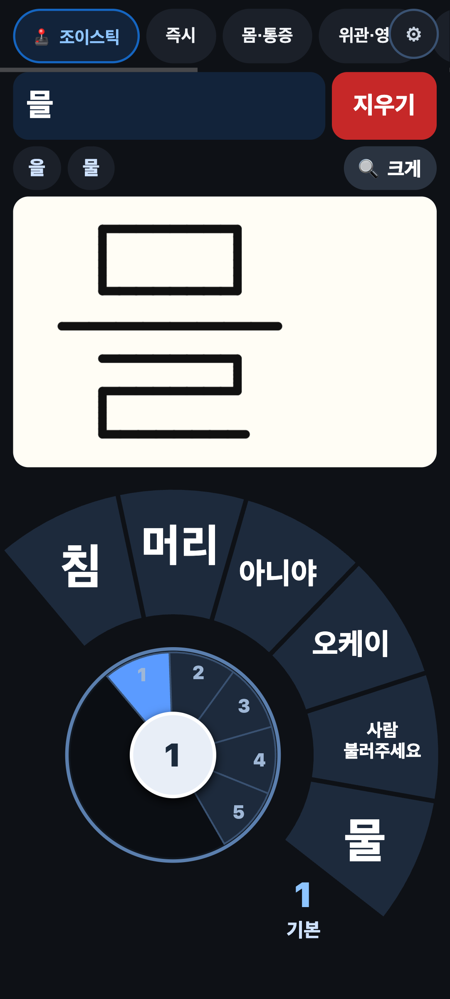

# 말해요 (Malhae) — 무료 의사소통 도우미 (AAC)

말은 어렵지만 손은 쓸 수 있는 분(루게릭병/ALS, 뇌졸중, 기관절개, 구음장애 등)을 위한 무료 웹앱입니다.
누르거나 손가락으로 쓰면 휴대폰이 소리 내어 말해 줍니다. 설치도, 가입도, 광고도 없습니다.

**바로 써 보기 (live demo):** https://ledeuxions.com/web-projects/malhae/

<p>


</p>

## 기능

- **문구 탭** — 즉시·몸/통증·위관/영양·가족/마음·신앙·의료/응급 등 묶음별 문구. 누르면 바로 말합니다.
- **조이스틱 + 호 띠** — 아래 왼쪽 조이스틱을 밀면 말 묶음이 바뀌고, 둘레의 호 모양 띠 칸을 누르면 그 말을 합니다.
- **손으로 글쓰기 → 글자 → 말** — 손가락으로 쓰면 글자로 바꿔 주고, 글자를 누르면 말합니다.
  인식에는 Google Input Tools의 **비공식** 필기 인식 주소를 씁니다(언제든 바뀌거나 막힐 수 있음).
  인식이 안 되면(인터넷 없음 등) 쓴 글씨 그림을 그대로 크게 보여 줍니다.
- **긴급 알람** — 화면 아무 데나 2초 꾹 누르면 빨간 화면 + 사이렌 + 「도와주세요」. 「멈춤」을 누르면 꺼집니다.
- **설정** — ⚙ 를 길게(3초) 누르면 칸 추가/삭제, 문구 고치기, 순서, 묶음, 좌우 바꾸기. (실수로 바뀌지 않게 길게 눌러야 합니다.)
- **오프라인** — PWA라 한 번 열면 인터넷이 끊겨도 동작합니다(손글씨 인식만 인터넷 필요).
- `type/` — 자판으로 써서 말하기. `eye/` — 눈 깜빡임으로 고르기(실험 중).

## 쓰는 법

1. 휴대폰/태블릿에서 위 링크를 엽니다.
2. 브라우저 메뉴에서 **홈 화면에 추가**를 누르면 앱처럼 쓸 수 있습니다.
3. 소리가 안 나면 기기 볼륨과 TTS(음성 합성) 설정을 확인하세요.

## 직접 올리기 (self-hosting)

빌드 과정이 없는 정적 파일입니다. 이 폴더를 그대로 아무 정적 호스팅(GitHub Pages, Netlify, Cloudflare Pages, 일반 웹서버)에 올리면 됩니다.
서비스 워커 때문에 `https://`(또는 `localhost`)에서 열어야 오프라인이 동작합니다.

```sh
python3 -m http.server 8000   # http://localhost:8000
```

## 개인정보

- 아무 정보도 수집하지 않습니다. 분석 도구·광고·서버 저장 없음.
- 설정과 고친 문구는 기기 안(localStorage)에만 저장됩니다.
- **손글씨 획(좌표)만** 글자 인식을 위해 Google로 보내집니다.
- `eye/` 의 카메라 영상은 기기 안에서만 처리됩니다(MediaPipe, 브라우저에서 실행). 영상은 어디로도 보내지 않습니다. 모델 파일만 CDN에서 내려받습니다.

## 라이선스

MIT © 2026 LeDeuxions

---

## English

**Malhae** ("Speak") is a free AAC (augmentative and alternative communication) web app for people who cannot speak but can use their hands — ALS, stroke, tracheostomy, dysarthria, etc. UI is in Korean; phrases are editable.

- Phrase tabs — tap to speak (Web Speech API).
- Joystick + arc band — push the joystick to switch phrase bundles, tap a band cell to speak.
- Handwriting → text → speech, using Google Input Tools' **unofficial** handwriting endpoint (may change or break); falls back to showing the ink enlarged.
- Hold anywhere for 2 seconds → emergency siren screen.
- Long-press ⚙ (3 s) to edit phrases/bundles.
- Offline-capable PWA; add to home screen.

Self-host: plain static files, no build. Serve over HTTPS (or localhost) for the service worker.
Privacy: no analytics, no accounts; settings stay in localStorage; only handwriting strokes are sent to Google for recognition; the experimental `eye/` page processes the camera locally in the browser.

License: MIT.
